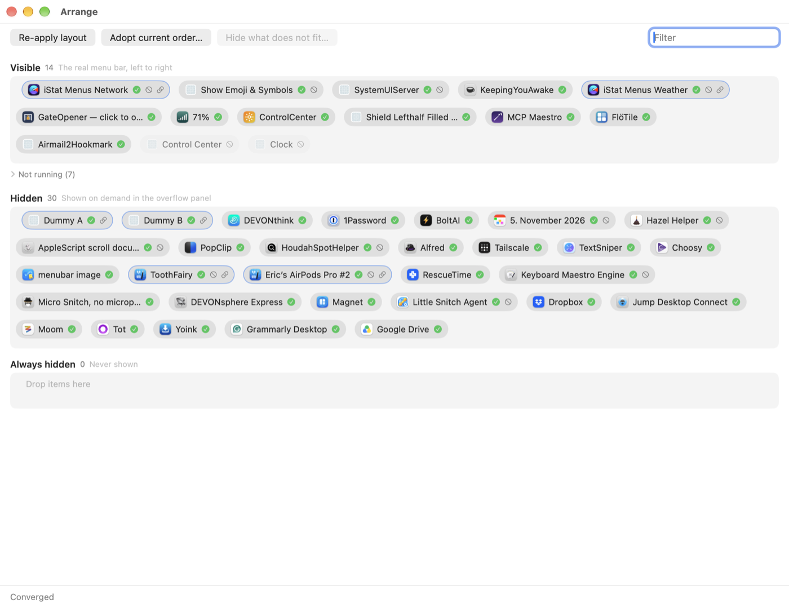

# Sommelier

An open-source menu bar item manager for macOS 26+, built as a Bartender alternative that does not lie.

Bartender's recurring failure mode is that it says it moved or hid an item and the item did not move, or the
order silently changed. Sommelier is built around one rule: **nothing is shown as done until the real menu bar
confirms it.** The UI renders observed state; what you asked for is shown separately as pending, moving or failed.

*The overflow panel opens under the menu bar and lists the hidden items.*

*The Arrange window: Visible, Hidden and Always hidden, each item badged with its observed state.*

## Status

Alpha (0.1.x). macOS 26 or later only. Developed and tested on macOS 27.0.1 (Xcode 27.1, Swift 6.4); macOS 26 is
assumed to behave the same but has not been verified. Single display only; multi-display is untested.

Logs: `~/Library/Logs/Sommelier/sommelier.log` (also in the unified log, subsystem `ie.boboco.sommelier`; status item menu, Open Log Folder).

## Requirements

- macOS 26 or later.
- **Accessibility permission (required).** Sommelier reads and arranges items through the Accessibility API.
- Screen Recording is **not** required. It only enables live item images in the overflow panel, and denying it is not an error.
- Sommelier is deliberately not sandboxed.

## Install

Before you start: quit Bartender (or any other menu bar manager). The engine pauses while another manager runs, because they fight each other.

1. Download `Sommelier-<version>.dmg` from the GitHub Releases page. It is signed with a Developer ID and notarized by Apple.
2. Open the DMG and drag Sommelier to Applications.
3. Launch it from Applications. macOS shows the usual "downloaded from the internet" confirmation; click Open.
4. Sommelier opens an onboarding window until Accessibility is granted. Grant it in System Settings > Privacy & Security >
   Accessibility (on macOS 27 the pane is called "Device Control and Data Access"). It starts working without a relaunch.

## Usage

- **Left-click** the Sommelier menu bar item: opens the overflow panel listing the hidden items. Click an entry to open
  that item's real menu; the item is hidden again after the menu closes.
- **Right-click** menu: Arrange..., Settings..., Start at login, Quit.
- **Arrange window**: three strips, Visible, Hidden and Always hidden. Drag and drop capsules within and across strips.
  Sommelier only moves items you placed in Arrange; everything else keeps the order macOS gives it. While an item you placed is being
  dragged the status line says why ("Moving X: you placed it after Y").
  The Visible strip mirrors the real bar and updates only when the bar has confirmed the move. Each capsule has a badge:
  - in place: the real bar matches the layout;
  - moving: the change is in flight;
  - failed: the move did not verify; hover for the error, "Retry" is in the context menu;
  - cannot move or hide: the item is greyed (for example system items, Apple apps);
  - does not fit: the item sits behind macOS's own overflow chevron because there is no room for it on the bar.
- **Always hidden**: items placed there stay hidden, including when the Hidden section is revealed.
- **Hide what does not fit...**: a manual button in the Arrange window toolbar, enabled only when items sit behind macOS's
  overflow chevron (a crowded bar, for example on a notched display). It opens a confirmation sheet and then hides those items
  so you can reach them from the panel instead. Sommelier never hides anything automatically.
- **Per-app caveat**: macOS hides all status items of one app together. If an app has two items, they share one visibility setting.

## How it works

Sommelier scans the menu bar through Accessibility, reading the tree hosted by macOS's `MenuBarAgent` process (menu bar items
are no longer separate per-app windows on macOS 26+) and each app's `AXExtrasMenuBar`. Hiding and showing is done live through
the Control Center preference domain (the per-app "Allow in the Menu Bar" flag), notified through cfprefsd without restarting
the agent; this needs the `group.com.apple.controlcenter` app-group entitlement, which the release build carries. Reordering
uses Cmd+drag with real mouse events, and every move is re-observed and compared with the intended order (closed loop) before
the UI marks it done. A failure is surfaced, never swallowed.

The design, the actuator strategy and the measurements behind it are in [docs/architecture.md](docs/architecture.md) and the
findings: [positioning](docs/findings-positioning.md), [visibility](docs/findings-visibility.md),
[live trigger](docs/findings-live-trigger.md), [drag](docs/findings-drag.md), [identity](docs/findings-identity.md),
[preference store](docs/findings-prefstore.md), [restart collateral](docs/findings-restart-collateral.md).

## Known limitations

- System items cannot be moved past Control Center and the clock.
- Apple apps' items cannot be hidden.
- Apps without a "Allow in the Menu Bar" entry in Control Center cannot be hidden yet.
- Reordering takes about 6-11 s because it uses real drags; hide/show takes 1-5 s, bounded by scan time.
- Items that macOS has pushed into its own overflow cannot be dragged. "Hide what does not fit..." in the Arrange window is a manual action and never runs automatically.
- Multi-display is untested.
- macOS 15 and earlier are not supported.
- Rebuilding from source changes the ad-hoc signature, so Accessibility must be granted again (see Troubleshooting).
  The notarized release keeps a stable identity across versions.

## Troubleshooting

- Not working after a rebuild, or Accessibility looks granted but is not effective:
  `tccutil reset Accessibility ie.boboco.sommelier`, relaunch, and grant again.
- `mbprobe list` prints what the scanner sees (use `make probe ARGS="list"` from a source checkout);
  `mbprobe permissions` prints the Accessibility and Screen Recording state and `live hide/show: available|unavailable`.
- Logs: a development run (`make app-run`) writes `build/sommelier.log`; look for `launch trusted=true`.
- The engine does nothing while Bartender is running; quit it.

## Building from source

    make build     # swift build
    make test      # swift test
    make app       # assemble and ad-hoc sign build/Sommelier.app
    make run       # build and open build/Sommelier.app (no Accessibility trust; prefer app-run)
    make app-run   # run the bundle binary directly so it inherits the terminal's Accessibility trust
    make release VERSION=x.y.z   # Developer ID signed + DMG in dist/ (see CONTRIBUTING.md)
    make probe ARGS="..."   # build (signs mbprobe with the app-group entitlement), then run the bin-path mbprobe
    make dummy [ARGS="--count 3 --removal-allowed"]   # build/MBDummy.app test status items
    make dummy-stop
    make clean

## mbprobe

    mbprobe list [--json] [--include-self] [--timing] [--debug]
    mbprobe set-position <bundleID> <autosaveName> <number> [--host] [--store legacy|agent]
        legacy (default): writes `NSStatusItem Preferred Position <autosave>` into the app's defaults domain
        (CFPreferences; --host = current host). Has no observable effect on macOS 26+/27.
        agent: edits `TrailingItemPreferredPositions` key `status:<bundleID>::<autosave>` in the MenuBarAgent
        group-container plist (atomic write). Takes effect after `mbprobe agent-restart`. Larger = further left.
    mbprobe watch [--seconds N]     poll the scanner every ~2 s, print order diffs (default 60 s)
    mbprobe agent-restart           killall MenuBarAgent, wait until the hosted item count recovers (10 s timeout), print elapsed ms
    mbprobe cc-allowed list         every tracked app with its "Allow in the Menu Bar" flag (1/0) from the Control Center plist
    mbprobe cc-allowed set <appKey> <0|1> [--restart] [--create] [--restart-cc]
        edits `isAllowed` inside the `trackedApplications` blob of group.com.apple.controlcenter.plist (atomic write, mode kept).
        appKey = bundle id (or the file URL for adhocBinary entries). Unknown keys are refused unless --create; `module:` and
        `com.apple.*` are always refused. 0 = hidden (parked), 1 = shown. Takes effect after `--restart` (killall MenuBarAgent);
        --restart-cc (kill system ControlCenter only) does NOT apply it.
    mbprobe set-visible <bundleID> <autosaveName> <0|1> [--host]
        legacy `NSStatusItem Visible <autosave>` write. Only honored when the owning app (re)launches; see docs/findings-visibility.md.
    mbprobe press <bundleID-or-key> [--escape-after SECONDS]
        AXPress on an app-side AXMenuExtra (works on parked items), prints resulting AXMenu/AXPopover child and windows.

See docs/findings-positioning.md and docs/findings-visibility.md.

## Permissions (reference)

- **Accessibility (required)**: System Settings > Privacy & Security > Accessibility
  (`x-apple.systempreferences:com.apple.preference.security?Privacy_Accessibility`).
- **Screen Recording (optional)**: live item images in the overflow panel
  (`x-apple.systempreferences:com.apple.preference.security?Privacy_ScreenCapture`).
- `SOMMELIER_SHOW_ONBOARDING=1` forces the onboarding window at launch.

## Developing

`open build/Sommelier.app` goes through LaunchServices; that bundle has no Accessibility grant until a human gives one.
A process started directly from the shell inherits the terminal's Accessibility trust (as `mbprobe` does), so for
development use `make app-run`, which builds the bundle and runs `build/Sommelier.app/Contents/MacOS/Sommelier` in the
background with logs in `build/sommelier.log` (look for `launch trusted=true`). Stop it with `pkill -x Sommelier`.
Live hide/show (cfprefsd-notified `isAllowed` write, no agent respawn) needs the `com.apple.security.application-groups`
entitlement for `group.com.apple.controlcenter` (`Resources/Sommelier.entitlements`). `make build` re-signs the built `mbprobe`
with it; `swift run mbprobe` re-links and runs an UNENTITLED binary, so use `make probe` or `$(swift build --show-bin-path)/mbprobe`.
`mbprobe permissions` prints `live hide/show: available|unavailable`; unentitled binaries use the respawn path automatically.
Debug env vars: `SOMMELIER_DEBUG_MENU=1`, `SOMMELIER_OPEN_SETTINGS=1`, `SOMMELIER_TOGGLE_LOGIN=1`, `SOMMELIER_SHOW_ONBOARDING=1`,
`SOMMELIER_OPEN_ARRANGE=1` (open the Arrange window at launch), and
`SOMMELIER_ARRANGE_MOVE="<storeKey>|<visible|hidden|always>|<index or ->"` (one move through the same code path as a drop, including its clamp, once the
engine has observed; the index is 0-based among MOVABLE items, modules do not count, 0 = first movable slot, 99 = before the trailing
system block; `mbprobe layout move` indexes are 1-based and unclamped; chain moves with `;`, space them with `SOMMELIER_ARRANGE_MOVE_INTERVAL=<seconds>`).
The hook needs no open Arrange window: it resolves capabilities from the engine's items exactly like a drop (`SOMMELIER_OPEN_ARRANGE=1` is only handy to watch the rows).
**`SOMMELIER_LAYOUT_FILE=<path>`** makes the app use that file instead of `~/Library/Application Support/Sommelier/layout.json`:
set it for every development run, so experiments never touch your real layout (the file is created on first launch from the current bar).

## License

MIT, Copyright (c) 2026 Eric Bowman. See [LICENSE](LICENSE). Contributing: [CONTRIBUTING.md](CONTRIBUTING.md).
